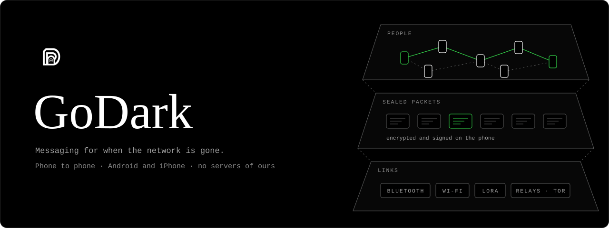
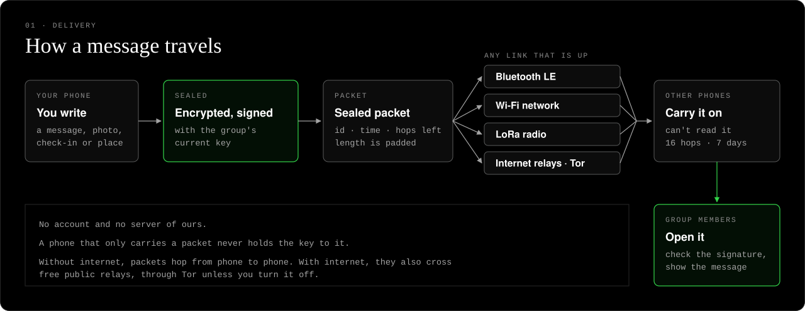
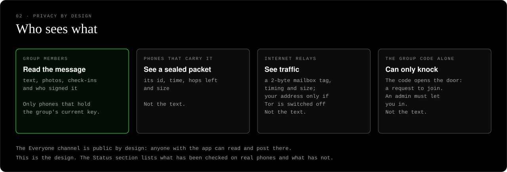
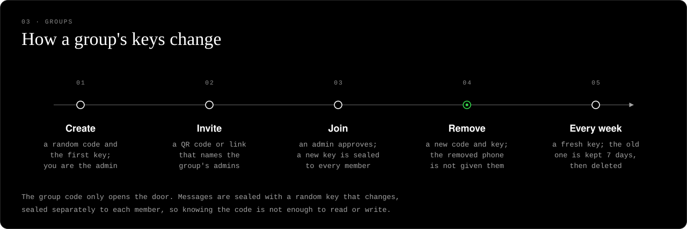

<h1 align="center">
  
</h1>

<p align="center">
  <b>An Android messaging app for when there is no internet and no mobile network.</b><br>
  Phones talk directly and pass messages along. This final build targets Android only; the older iPhone source is retained but is not part of this release.
</p>

<p align="center">
  
  
  <a href="spec/FORMAT.md"></a>
  
  
</p>

<p align="center">
  <b>Website source: static GoDark pages in <code>site/</code></b> · <a href="docs/cloudflare-pages.md">Hosting notes</a> · <a href="PRIVACY.md">Privacy draft</a> · <a href="TERMS.md">Terms draft</a> · <a href="spec/FORMAT.md">Wire format</a><br>
  <a href="#install-the-app">Install</a> · <a href="#how-it-works">How it works</a> · <a href="#features">Features</a> · <a href="#build">Build</a> · <a href="#ai-models">AI models</a> · <a href="#status">Status</a> · <a href="#known-limits">Known limits</a>
</p>

GoDark is an Android messaging app for when there is no internet and no mobile network. Phones talk to each other directly and pass messages along, so a message can reach someone who is out of range of the sender. While there is internet, messages may also travel through independent public relays. The optional GoDark account service source is included in `account-service/`, but its real HTTPS origin is blank and its readiness checks remain disabled in this source snapshot, so account and telemetry requests are not sent and accounts are unavailable. Messaging works offline without signing in. Android includes a built-in on-device AI assistant: the first time you open Ask, GoDark prepares its Gemma 4 E2B model over Wi-Fi only (about 2.6 GB); the model stays on the phone and works offline after setup. The model is downloaded separately and is not bundled inside the APK. An optional LoRa radio extends the range to kilometres.

The repository retains iPhone source using the same message format, but this final build request targets **Android only**; no iOS build is being prepared.

## Install the app

### Android

There is no Google Play listing or public GitHub Release from this repository. The Android 0.5 direct-install APK is signed only when an owner-controlled release key is supplied to the build. This is not a Play Store submission. Account and telemetry requests remain unavailable because the public HTTPS API origin is blank; the Terms and Privacy pages are drafts and still need legal review before public launch.

For a debug test build or signed release, follow the [Android build instructions](#android). Android requires version 8.0 (API 26) or newer and Google Play Services.

### iPhone

There is no public TestFlight or App Store release yet. For a developer build, follow the [iPhone build instructions](#iphone). The project includes a [pre-release TestFlight checklist](docs/TESTFLIGHT.md); it is not evidence that a build has been submitted or approved.

## How it works



A message is encrypted and signed on your phone, then leaves over whatever link is up. The phones in between carry it without being able to read it.



This is what each party is meant to see. [Status](#status) says what has been checked on real phones and what has not.



The group code only opens the door. Messages are sealed with a random key that changes, so the code alone neither reads nor writes. The exact rules are in [spec/FORMAT.md](spec/FORMAT.md).

## Features

- **Group chat with end-to-end encryption.** A group code lets a phone ask to join, and an admin lets it in. Messages are encrypted with AES-256-GCM under a random group key that changes every week and whenever someone joins or is removed, and every message is signed by its sender. Phones that relay a message can't read it.
- **Mesh forwarding.** Every phone stores messages and passes them on to the phones it meets:
  - Duplicates are dropped.
  - Each message can be relayed up to 16 times.
  - Each phone passes on up to 500 messages, for 7 days. Your group's messages stay readable on the phone for one to two weeks; the phone keeps the newest 2,000 Everyone messages, and forgets other groups' messages it can't read after 7 days.
- **Ways phones connect:**

  | Connection | Android | iPhone |
  |---|---|---|
  | Google Nearby Connections (Bluetooth and Wi-Fi Direct) | ✓ | |
  | Bluetooth LE, so Android and iPhone can talk to each other | ✓ | ✓ |
  | Apple peer-to-peer (MultipeerConnectivity) | | ✓ |
  | Wi-Fi networks: a router with no internet, a hotspot, a community network or a rooftop link | ✓ | ✓ |
  | LoRa through a Meshtastic radio (EU 868 MHz), over Bluetooth | ✓ | ✓ |
  | LoRa through a MeshCore radio (firmware 1.15 or newer), over Bluetooth | ✓ | ✓ |
  | Internet: public Nostr relays, optionally through Tor built into the app | ✓ | ✓ |

  The **Connections** screen shows all of them: what is linked now, an on/off switch for Wi-Fi networks, an address to
  type when phones don't find each other, and pairing for both kinds of radio. **Send via another app** shares an
  "I'm safe" or "I need help" (with battery and position) as plain text, for satellite messengers such as Garmin
  inReach, or for text messages once the network is back.

- **Built-in Android AI that runs on the phone.** On first opening Ask, GoDark downloads Gemma 4 E2B over Wi-Fi only (about 2.6 GB), verifies the file size and SHA-256, and installs it for offline use. No model picker or delete switch is shown. The APK itself stays small; the model is downloaded separately. LiteRT-LM uses the phone's GPU when it works and falls back to CPU. The AI needs a phone with at least 4 GB of memory; the rest of GoDark remains usable while setup runs.
- **Groups and people (iPhone and Android):**
  - "Create a group" makes a strong random code. Friends join by scanning the invite QR with their phone camera, or by an invite link sent over AirDrop, Quick Share or any app. Both apps emit the established `darkproof://join` URI so existing installations and invites remain compatible; the app label and interface are GoDark.
  - The People tab shows who is in your group, who is in range now, and when you last heard from everyone else.
  - **I'm safe** and **Need help** check-in buttons.
  - Groups you leave are kept (up to 20), so you can switch back.
  - Typed codes are tidied (lowercase, spaces, missing dashes, pasted links), and GoDark has its own QR scanner.
  - Each group shows five emoji to compare out loud with a friend's phone, which catches a fake invite QR.
- **Safety features (iPhone and Android):**
  - Check-ins carry your battery level and, if you turn it on, your position. A compass points to a friend's last known position.
  - **I need help** with one tap, then optional details: injured, trapped, need water, food, medicine or shelter, and how many people.
  - **Are you safe?** asks your group, or one person, who answer with one tap (also from the notification).
  - **Check in for someone else** ("Grandma is safe"), always shown as reported by you.
  - **Shortcuts:** "I'm safe" and "I need help" from Siri, Spotlight, the Action button and Shortcuts on iPhone; a quick-settings tile and app shortcuts on Android.
  - **Get ready** checklist on Home (invite people, save the map, download the AI, add the shortcut, practise) and a **practice run** that sends nothing.
  - **Plus Codes** next to every position, easy to read out over a radio or a phone call.
  - Alerts inside the app too, unread badges, and every saved group is read, so a family member's "I need help" reaches you while another group is open.
  - **Places:** share where there is water, shelter, charging or medical help, for everyone nearby.
  - **Small photos** (up to 14 KB) for your group, and **delivery status** ("Delivered to Anna").
- **Offline street maps:** the Home shortcut opens the map and its download card directly. Save an area about 10 km around you while you have internet (OpenFreeMap, up to 50 MB), then view that saved area offline.
  - Alerts for new group messages, made on the phone.
- **Internet relays.** With Wi-Fi or mobile data, every message also goes up to six free public Nostr relays, encrypted as always, and comes down on the phones it is for. These independent relays are not the optional account service: each phone signs with a new random key at every start, and accounts do not participate in mesh, message or relay handling.
  - Packets carry a 2-byte "mailbox" tag, so a phone asks only for its group's and the Everyone channel's packets.
  - A phone with internet also passes on its neighbours' packets. In a blackout, one phone that still has internet (a satellite link, a working mast) connects its whole neighbourhood to the world.
  - Each phone posts its own new messages first. Anyone else's go up only if no relay has them yet, slowly, and relays that ask phones to slow down are paused.
  - **Connect through Tor** (on by default) runs Tor inside the app (tor-android on Android, Tor.framework on iPhone), so relays don't see the phone's internet address. Nothing goes to the relays until a check through Tor passes.
  - Details: `spec/FORMAT.md`, "Internet relays".
- **Everyone channel.** Anyone with GoDark can read and post on it, whatever their group, nearby or online. Every phone relays every message, including messages from other groups that it cannot read. Offensive words in other people's posts are masked; hold a message to report it or block its sender. Operator/support contact is not configured in this source snapshot.
- **Android extras:**
  - **Share app:** sends the app itself to another Android phone over Quick Share or Bluetooth, with no internet.
  - **Wi-Fi board:** the phone opens its own Wi-Fi network and a web page, so people without the app can read and post Everyone messages from a browser.
- **Testing on a computer.** An Android emulator and an iPhone Simulator link over the Wi-Fi network transport: run `adb forward tcp:7778 tcp:7777`, then type `127.0.0.1:7778` in the iPhone's Connections screen. Debug builds also have test hooks (sample messages, an AI self-test).

## Repository layout

| Path | Contents |
|---|---|
| `app/` | Android app (Kotlin, minSdk 26) |
| `ios/Blackout/` | iPhone app (SwiftUI, iOS 16.4+) |
| `ios/BlackoutCore/` | Swift package: packet format, encryption, forwarding, Bluetooth LE and Meshtastic protocol logic |
| `ios/Vendor/fetch-llama.sh` | Downloads the pinned llama.cpp build for iPhone |
| `spec/FORMAT.md` | Wire format and Bluetooth LE protocol, shared by both apps |
| `spec/test-vectors.txt` | Byte-exact examples that both apps' tests check |
| `PRIVACY.md`, `TERMS.md` | Draft disclosures; legal review and provider backup-retention verification are required before any account service or finished app launch |
| `docs/diagrams/` | This page's banner and diagrams, drawn by `tools/make-diagrams.py` |
| `site/` | Static landing, draft policy and unavailable-account pages for Cloudflare Pages; no account backend or analytics (see `docs/cloudflare-pages.md`) |
| `account-service/` | Separate Node.js/MySQL account API source, database migration, tests and deployment recipe; not deployed and gated pending retention, backup, security and legal review |
| `tools/` | Test tools: a Mac Bluetooth LE test peer, an AI check, the test-vector generator, and the diagram generator |

## Build

### Android

1. You need Android Studio, or the Android SDK with platform 35 and JDK 17 or newer. The build uses Android Gradle Plugin 8.13.2: tor-android's code is built for Java 24, which older plugins can't read.
2. Create `local.properties` containing `sdk.dir=<path to your Android SDK>`.
3. For a debug/test build:
   ```bash
   ./gradlew assembleDebug
   ```
4. For a signed Android 0.5 release, provide these environment variables from a secure secret manager or protected local environment, then run the tests and release build:
   ```bash
   export GODARK_KEYSTORE=/secure/path/release-key.jks
   export GODARK_KEY_ALIAS=your-release-alias
   read -rsp 'Keystore password: ' GODARK_STORE_PASSWORD; echo
   read -rsp 'Private-key password: ' GODARK_KEY_PASSWORD; echo
   export GODARK_STORE_PASSWORD GODARK_KEY_PASSWORD
   ./gradlew testDebugUnitTest assembleRelease --no-daemon
   unset GODARK_STORE_PASSWORD GODARK_KEY_PASSWORD
   ```
   Keep the keystore and passwords out of Git and source ZIPs. The release build fails unless all four signing variables are set. Back up the key: Android will reject updates signed with a different certificate.
5. Install. You need a phone with Google Play Services. For a debug/test build, install `app/build/outputs/apk/debug/app-debug.apk`; for a signed release, install `app/build/outputs/apk/release/app-release.apk` and keep the same signing key for updates.
   ```bash
   adb install -r app/build/outputs/apk/release/app-release.apk
   ```

### iPhone

1. You need Xcode 27 or newer.
2. Run this once to download llama.cpp (pinned release, checked against its SHA-256):
   ```bash
   ios/Vendor/fetch-llama.sh
   ```
3. Open `ios/Blackout.xcodeproj`. Xcode fetches the Swift packages, including Tor.framework (a 141 MB download, pinned to 409.15.3).
4. Under Signing & Capabilities, pick your Team. A free Apple ID works, but the app then has to be reinstalled every 7 days.
5. Select your iPhone and press Run.

Simulator builds work too. They don't include the AI, and the Simulator has no Bluetooth.

### Tests

```bash
./gradlew testDebugUnitTest          # Android
cd ios/BlackoutCore && swift test    # Swift core
```

## AI models

### iPhone

The app downloads a model once, while internet is available, and checks its SHA-256. It offers only the models that fit the iPhone's memory, and shows how long answers take on that iPhone (measured once used, estimated before).

| Model | Size | License | Offered on | On an iPhone 15 |
|---|---|---|---|---|
| Gemma 4 E2B (recommended) | 2.8 GB | Apache 2.0 | iPhones with 6 GB or more | 3–21 s per answer |
| Qwen 3.5 4B | 2.7 GB | Apache 2.0 | iPhones with 6 GB or more | 11–60 s per answer |
| Gemma 4 E4B | 4.6 GB | Apache 2.0 | iPhones with 8 GB or more | not tested yet |
| Qwen 3.5 2B | 1.4 GB | Apache 2.0 | iPhones with 4 GB (11, 12, 13, SE) | less reliable |

### Android

Google's LiteRT-LM runs the single required Android assistant on the phone. On first opening Ask, the model is downloaded over Wi-Fi only and its size and SHA-256 are checked before use. It runs on the GPU when supported (otherwise CPU) and keeps the conversation locally. Model setup needs about 2.6 GB of free space plus temporary headroom, and a phone with at least 4 GB of memory. The AI model is a separate download, not embedded in the APK.

| Model | Size | License | Offered on | On an Android emulator (4 CPU cores, 4 GB) |
|---|---|---|---|---|
| Gemma 4 E2B (required) | 2.6 GB | Apache 2.0 | phones with 4 GB or more | 2–7 s per answer, on the CPU |

Emulator times come from a Mac and are not phone times.

The official instruct model is pinned to a reviewed revision and checked before use. The assistant also gets the group's latest check-ins, battery levels and shared places with each question, so it can answer "who hasn't checked in?". Group data can be stale; AI advice can be wrong and is not a substitute for trained emergency or medical help.

Small models can be wrong. In a real medical emergency, use the AI's answers carefully.

## Status

**Verified:**
- All unit tests pass.
- Chat, relaying and encryption between two Android emulators, both over a TCP test link and over the emulators' simulated Bluetooth LE.
- An iPhone Simulator and an Android emulator linked over the Wi-Fi network transport (address typed by hand, as on networks that block discovery).
- An iPhone Simulator and an Android emulator in one group, over a TCP link: check-ins with battery and position, places, photos and delivery status in both directions; an Android invite QR and link; messages written while offline arriving after reconnecting.
- On an Android emulator: the offline map saved, then shown with airplane mode on; alerts while the app is in the background; picking and sending a photo.
- The Android AI on an emulator: downloading and checking Gemma 4 E2B, answering the same test questions as the iPhone (including a follow-up and a question about the group), and falling back to the CPU when the GPU can't run.
- Two iPhone Simulators connecting over Apple peer-to-peer.
- Online mode, live on public relays (emulator and Simulator with no other link): group messages, photos, check-ins, receipts and Everyone messages in both directions; Sent and Delivered labels; no re-posting after restarts.
- Tor built into both apps, live: each linked to the relays through its own Tor, messages crossed both ways, and no connection went around Tor (checked with `lsof` and `/proc/net/tcp`). With Tor on but not running, nothing reached the relays.
- Between an Android emulator and an iPhone Simulator over the Wi-Fi network link, with internet off: "I need help" with needs and head count, "Are you safe?" and its one-tap answer, check-ins, photos and delivery receipts in both directions.
- A real iPhone 15 exchanging messages with a Mac over real Bluetooth LE.
- The AI running on a real iPhone 15.
- On a real iPhone 15, over real Bluetooth LE: messages arrive while the phone is locked, and the link comes back after the other side restarts.
- Relaying across groups, and the Public channel, between a real iPhone and a Mac.
- On an Android emulator: the Wi-Fi board (its own Wi-Fi network, the page in a browser, posting in both directions), and the share sheet for sharing the app.

**Not verified yet:**
- Account API integration against the production backend, end-to-end consent changes/deletion, provider backup expiration, and account-service operational/security readiness. The API origin is blank by design; these account features are unavailable in this build.
- Android on real phones, including sending the app to another phone and a real phone joining the Wi-Fi board.
- The Android AI on a real phone, including its GPU.
- Wi-Fi network discovery between real phones (Bonjour/mDNS); the emulator and the Simulator can't see each other's announcements.
- MeshCore radios: built from MeshCore's source code and tested byte by byte, but never connected to a real radio.
- iPhone and Android over real Bluetooth.
- Online mode and Tor on real phones over mobile data, and how relays rate-limit many phones behind one carrier address.
- The relay changes since the live test (catch-up per mailbox, "Sent" only after a relay accepts, existence checks), the Bluetooth link limits, shortcuts from Siri and the Action button, the Android quick-settings tile from the lock screen, battery estimates, and restart after reboot.
- iPhone to iPhone on real devices.
- LoRa with real Meshtastic radios.
- Battery use and range.

## Privacy and TestFlight

- Privacy and terms: [PRIVACY.md](PRIVACY.md) and [TERMS.md](TERMS.md) are drafts, not approved public policies. Legal review and provider backup-retention verification are launch blockers. The native account API base is intentionally blank, so this source snapshot cannot create or contact accounts and sends no account or telemetry data.
- Accounts are optional. Offline messaging works without sign-in. If enabled, account fields are limited to email, display name, password hash, account identifier and dates, Terms/Privacy versions, and consent choices/times. IP and sign-in/security events are retained for 30 days; account deletion is intended within 30 days.
- Usage analytics requires separate opt-in and contains allowlisted feature names and event timestamps only (12 months). Diagnostics requires separate opt-in and contains app/device/OS/app version, allowlisted incident type and category hash only (90 days). Neither includes message contents, group codes/keys, contacts, check-in contents or precise location.
- Provider backup expiration within 90 days is unverified and a launch blocker; it is not a verified retention promise. Offline messaging does not require an account.
- Operator identity and support contact are not configured. Do not rely on an account or support channel for emergency help.
- Before App Store submission, complete and verify App Store Connect privacy labels separately from the iOS privacy manifest; the two disclosures are not interchangeable.
- How to put the iPhone app on TestFlight: [docs/TESTFLIGHT.md](docs/TESTFLIGHT.md).

## Known limits

- Android needs Google Play Services.
- iOS restricts background work. The iPhone AI only runs while the app is on screen.
- LoRa carries only short messages (about 160 characters), one every 20 seconds, and only messages from the last 30 minutes.

## License

Third-party code: llama.cpp is MIT-licensed (see `ios/Vendor/LICENSE-llama.cpp.txt`). Tor is BSD-licensed; it comes from tor-android (Guardian Project, BSD) on Android and Tor.framework (iCepa, MIT) on iPhone. AI models have their own licenses, listed above.

This project doesn't have a license of its own yet.
